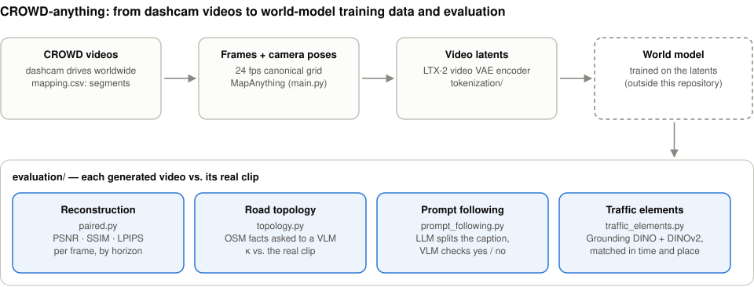
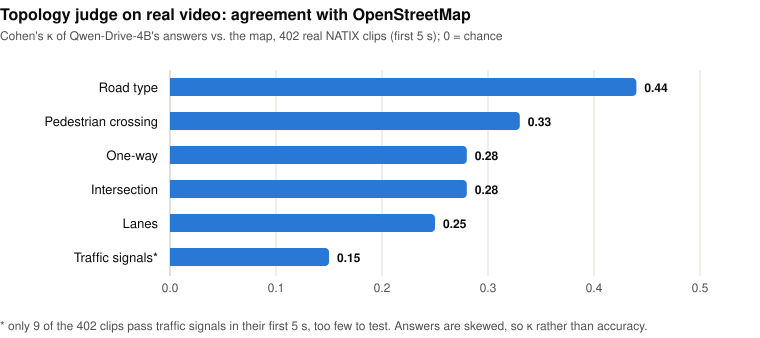
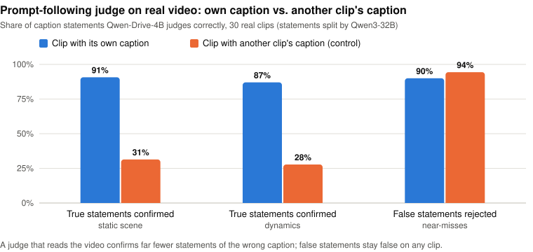

# CROWD-anything

[](https://www.python.org/downloads/release/python-31213/)
[](https://docs.astral.sh/uv/)
[](https://github.com/vita-epfl/CROWD-anything/actions/workflows/linter.yml)

CROWD-anything turns the dashcam drives of the [CROWD](https://github.com/crowd-dataset/crowd) dataset into training
data for driving world models, and evaluates the videos such models generate. It recovers camera poses with
[MapAnything](https://github.com/facebookresearch/map-anything), encodes clips into
[LTX-2](https://github.com/Lightricks/LTX-2) video latents, and scores generated videos against their real clips:
how exactly they reproduce them, whether they show the road layout of the map they were given, whether they follow
their text caption, and whether they show the real traffic signs and lights in the right place.

<p align="center">
  
</p>

## Contents

- [What is in this repository](#what-is-in-this-repository)
- [Getting started](#getting-started)
- [Camera poses with MapAnything](#camera-poses-with-mapanything)
- [Tokenization with the LTX-2 video VAE](#tokenization-with-the-ltx-2-video-vae)
- [Evaluation of generated driving videos](#evaluation-of-generated-driving-videos)
- [Citation and contact](#citation-and-contact)

## What is in this repository

| Path | What it does |
|---|---|
| [`main.py`](main.py) | Selects the video segments of `mapping.csv`, downloads missing videos, extracts frames and runs MapAnything to get camera poses (JSONL per segment) |
| [`tokenization/`](tokenization) | Encodes the clips of a sample manifest into LTX-2 video VAE latents, at several resolutions |
| [`evaluation/`](evaluation) | Scores generated driving videos against their real clips (reconstruction, road topology, prompt following, traffic elements) |
| [`benchmarking/`](benchmarking) | Pose and depth benchmarks of MapAnything |
| [`scripts/clariden/`](scripts/clariden) | Jobs for the CSCS Clariden cluster (e.g. fetching CROWD videos) |
| [`demo/`](demo) | A GPS annotator for demo videos (video time to map position) |

## Getting started

Tested with **Python 3.12.13** and the [`uv`](https://docs.astral.sh/uv/) package manager.

```bash
curl -LsSf https://astral.sh/uv/install.sh | sh        # 1. install uv (Windows: irm https://astral.sh/uv/install.ps1 | iex)
git clone https://github.com/vita-epfl/CROWD-anything.git
cd CROWD-anything
uv python install 3.12.13                               # 2. the Python version in .python-version
uv sync --frozen                                        # 3. .venv with the locked dependencies (add --extra eval for evaluation/)
source .venv/bin/activate                               # Windows: .\.venv\Scripts\Activate.ps1
```

<details>
<summary><b>If uv reports "Permission denied (os error 13)"</b></summary>

`uv` keeps its Python builds in `~/.local/share/uv/python` (macOS/Linux) or `%LOCALAPPDATA%\uv\python` (Windows). If
another tool (e.g. `sudo`) created that folder, take ownership of it:

```bash
mkdir -p ~/.local/share/uv
chown -R "$(id -un)":"$(id -gn)" ~/.local/share/uv
chmod -R u+rwX ~/.local/share/uv
```

```powershell
New-Item -ItemType Directory -Force "$env:LOCALAPPDATA\uv"
icacls "$env:LOCALAPPDATA\uv" /grant "$($env:UserName):(OI)(CI)F"
```
</details>

## Camera poses with MapAnything

Place **mapping.csv** in the repository root (or set `mapping` in `config`). Videos found in the configured `videos`
folders are used directly; missing videos are downloaded from `base_url` with the credentials in the `secret` file
(see `default.secret`). Then run:

```bash
python3 main.py
```

<details>
<summary><b>Configuration</b></summary>

The configuration is read from `config`, with the structure of `default.config`. Values in `config` override
`default.config`, and any parameter missing from `config` falls back to its value in `default.config`.

| Parameter | Meaning |
|---|---|
| `mapping` | CSV file with the mapping data used to select videos and time segments |
| `videos` | Directories with local video files |
| `base_url` | Base URL of the remote file server videos are downloaded from |
| `download_dir` | Temporary directory for downloaded videos |
| `RUNS_DIR` | Where output JSONL files and intermediate run files are stored |
| `MAPANYTHING_FPS` | Frame sampling rate for frame extraction and timestamps during inference |
| `ENABLE_VIZ` | Enables visualisation options where the pipeline supports them |
| `DELETE_DOWNLOADED_VIDEO` | Deletes downloaded videos once they are processed |
| `DELETE_FRAMES_AFTER_PROCESSING` | Deletes extracted frames once MapAnything inference has finished |
| `KEEP_GOING` | Continues with the remaining videos when one fails |
| `OVERWRITE_FRAMES` | Re-extracts frames even if they already exist |
| `TARGET_LOCALITY` | Processes only one locality of the mapping CSV (`null`: all) |
| `TARGET_ROW_ID` | Processes only one row of the mapping CSV (`null`: all) |
| `MAX_VIDEOS_TO_PROCESS` | Limits the number of videos (`null`: no limit) |
| `SKIP_EXISTING_OUTPUTS` | Skips segments whose output JSONL already exists in `RUNS_DIR`, so interrupted runs resume; videos whose segments are all done are not downloaded again |
</details>

## Tokenization with the LTX-2 video VAE

The `tokenization` package encodes the clips of a [wm-data-manifest](../wm-data-manifest) sample manifest into
[LTX-2](https://github.com/Lightricks/LTX-2) video VAE latents (the DiffVAE,
`vae/ltx-2.5-video-vae-bf16.safetensors` from LTX-2.5); audio is not used. Only the VAE encoder runs.

**Frames** are decoded exactly as the manifest defines them: each video in one ffmpeg pass from its start through the
canonical `fps=24` filter (frame *i* at *t = i / 24*), then the manifest's `[start_frame, end_frame)` ranges (121
frames, consecutive clips sharing one frame) are taken from that stream. Tests check this against wm-data-manifest's
own `count_resampled_frames` and `canonical_resample_command`, including for variable frame rate videos.
Preprocessing is the same as `ltx-trainer`'s (resize keeping aspect ratio, bicubic, center crop, scale to [-1, 1]).

**Encoding** (install `ltx-core` and `ltx-trainer` from the LTX-2 repository first):

```bash
python -m tokenization.encode encode samples_24fps.parquet latents/ --video-root /path/to/crowd/videos \
    --vae-checkpoint /path/to/vae/ltx-2.5-video-vae-bf16.safetensors --resolution 960x544 512x288
```

The manifest can be the consolidated parquet file or its partition directory; `--countries` restricts it. For several
GPUs, start one process per GPU (for example `torchrun --nproc_per_node 4 -m tokenization.encode encode ...`), then
build the index once all processes are done:

```bash
python -m tokenization.encode index latents/
```

Each resolution is written to its own directory (`latents/960x544/`, `latents/512x288/`, ...). Every video is decoded
once and encoded at every requested resolution, and a resolution can be added later without re-encoding the others.
Reruns resume where they stopped. An output directory refuses latents encoded with different settings (checkpoint,
clip length, frame decoding).

**Output:** per resolution, latents are stored per source video in `shards/<xx>/<video_id>.<part>.safetensors` (at
most 1024 clips per file, so almost always one file per video), progress is logged in one `progress/rank<k>.jsonl`
per process, and `index.jsonl` lists every clip. For the full CROWD mapping this is about 76k files per resolution.
`tokenization.shards.LatentClipDataset` loads single clips in the layout of `ltx-trainer`'s precomputed latents
(`latents` [C, F', H', W'], `num_frames`, `height`, `width`, `fps`).

## Evaluation of generated driving videos

Every generated video is compared with the real clip it was generated for. Where a vision-language model (VLM) is
the judge, the same questions are asked on the real clip, so the judge's own errors on real video can be measured and
discounted, and a control (the real video asked about another clip) shows that the judge looks at the video at all.
Install the extra dependencies with `uv sync --extra eval`; details are in [`evaluation/README.md`](evaluation/README.md).

| Evaluation | Question | Method |
|---|---|---|
| **Reconstruction** ([`paired.py`](evaluation/paired.py)) | How exactly does the model reproduce the real video? | PSNR, SSIM and LPIPS per frame on the same 24 fps grid, averaged over horizons (5 s to 1 min) |
| **Road topology** ([`topology.py`](evaluation/topology.py)) | Does the video show the road layout of the map it was given? | OpenStreetMap facts along the trajectory (road type, lanes, one-way, intersection, crossing, signals) asked as multiple-choice questions to a VLM |
| **Prompt following** ([`prompt_following.py`](evaluation/prompt_following.py)) | Does the video show what its caption says? | An LLM splits the caption into checkable statements plus near-miss false ones; a VLM answers yes / no to each |
| **Traffic elements** ([`traffic_elements.py`](evaluation/traffic_elements.py)) | Are the real traffic signs and lights there, in the right place? | Grounding DINO on the whole frame and on tiles, DINOv2 appearance features, tracks matched by box-centre distance frame by frame |

**How reliable are the VLM judges?** Measured on real video only, before any generated video is scored. The topology
judge agrees with the map above chance on every question, but only moderately, so results are reported as agreement
with the real clip's answers, which cancels the judge's own errors:

<p align="center">
  
</p>

The prompt-following judge confirms 87–91% of the statements of a clip's own caption, but only 28–31% of another
clip's caption, and rejects 90% of the deliberately false statements:

<p align="center">
  
</p>

Typical runs (clips.csv has columns `clip_id,side,video`, where side `reference` is the real video):

```bash
python -m evaluation.paired --generated gen/ --reference gt/ --out results/paired --horizons 5,10,30,60
python -m evaluation.topology score --clips clips.csv --facts facts.json --out results/topology \
    --vqa-url http://localhost:8000/v1 --model <served VLM>
python -m evaluation.caption_statements --captions captions.csv --model Qwen/Qwen3-32B --out statements.json
python -m evaluation.prompt_following export --clips clips.csv --statements statements.json --out batch/
python -m evaluation.traffic_elements detect --clips clips.csv --anchors anchors.json \
    --detector IDEA-Research/grounding-dino-base --features facebook/dinov2-base --out detections/
python -m evaluation.traffic_elements score --clips clips.csv --detections detections/ --out results/traffic
```

The figures are drawn by [`docs/figures/make_figures.py`](docs/figures/make_figures.py).

## Citation and contact

A paper describing this work is in preparation; the citation will be added here.

The code is open-source and free to use. It is aimed for, but not limited to, academic research. We welcome forking
of this repository, pull requests, and any contributions in the spirit of open science and open-source code. For
inquiries about collaboration, you may contact Md Shadab Alam (md_shadab_alam@outlook.com).
